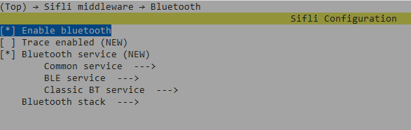
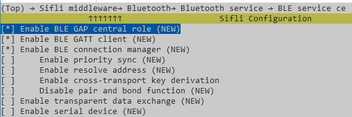
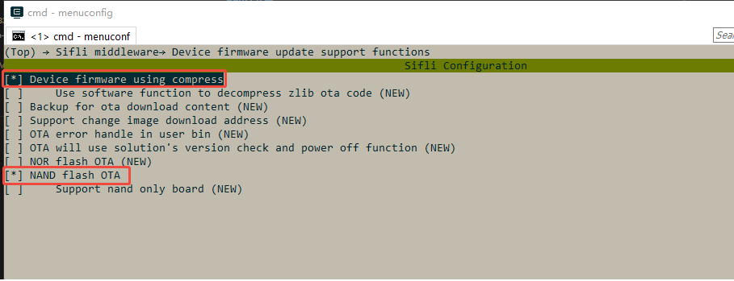
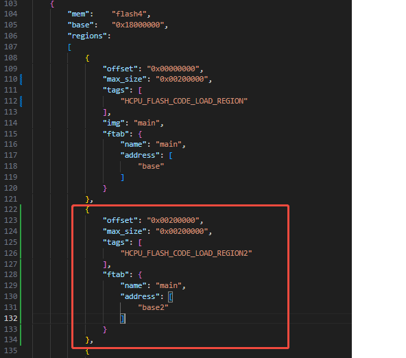
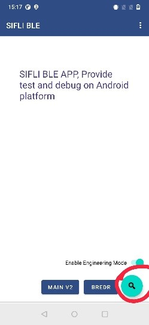
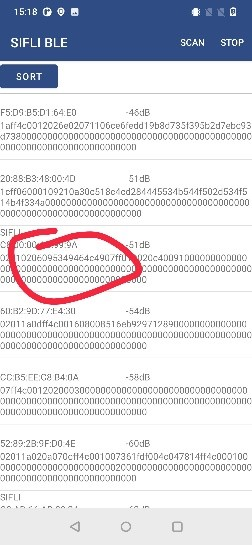
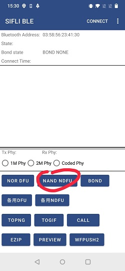
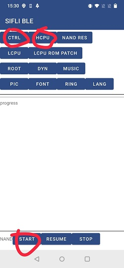

<p align="center">
  
</p>

<h1 align="center">Ajie Try</h1>
<p align="center">
  <strong>BLE 5.0 双模无线通信 · 一站式示例工程</strong>
</p>

<p align="center">
  
  
  
  
  
</p>

---

## 📖 简介

本项目是 **Sifli（思澈科技）SF32LB5x 系列** 蓝牙 SoC 的完整示例工程，演示了如何在一块芯片上同时运行 **BLE Central** 和 **Peripheral** 双角色，并通过 **PingPong OTA** 机制实现安全可靠的无线固件升级。

> 🎯 适合作为智能手表、手环、健康追踪器等穿戴设备的基础通信框架。

### 🧩 核心技术栈

| 层级 | 技术 |
|:---|:---|
| RTOS | **RT-Thread** (国产实时操作系统) |
| 无线协议 | **Bluetooth LE 5.0** |
| 芯片平台 | **Sifli SF32LB52 / 55 / 56 / 58** 系列 |
| 构建系统 | **SCons** |
| Shell | **Finsh** (RT-Thread 命令行组件) |

---

## ✨ 功能概览

<table>
<tr>
<td width="50%">

### 📡 Peripheral（从设备）
- 🔵 开机自动广播，名称 `SIFLI_APP-<BT_ADDR>`
- 🛠️ 自定义 128-bit GATT Service
- 📖 Read / ✏️ Write / 🔔 Notify / 📢 Indicate
- 📱 兼容 LightBlue (iOS) / nRF Connect (Android)

</td>
<td width="50%">

### 🔍 Central（主设备）
- 📡 主动扫描周边 BLE 外设
- 🔗 发起/取消连接，管理多设备
- 🔎 自动搜索远程 GATT Database
- 📨 远程读写特征值、订阅 CCCD

</td>
</tr>
<tr>
<td>

### 🔄 PingPong OTA
- 📦 双分区乒乓升级，失败自动回滚
- 📲 Sifli BLE App 一键无线升级
- 🔐 签名校验，安全可靠

</td>
<td>

### 💻 Finsh 命令行
- ⌨️ 完整的 `diss` 命令集
- 🎛️ 交互式控制所有 BLE 行为
- 🧪 一键压测、调参、调试

</td>
</tr>
</table>

---

## 🚀 快速上手

### 前置条件

- 一块 Sifli 开发板（见下方平台列表）
- USB 转串口线
- 编译环境：[RT-Thread SCons 工具链](https://www.rt-thread.org/)

### 编译

```bash
cd project/hcpu

# SF32LB58 系列
scons --board=sf32lb58-lcd_n16r64n4 -j8

# SF32LB55 系列
scons --board=eh-lb555 -j8

# SF32LB52 系列
scons --board=sf32lb52-lchspi-ulp -j8
```

### 烧录

```bash
cd project/build_<board>

# 方式一：JLINK
./download.bat

# 方式二：UART（52x 系列）
./uart_download.bat   # 按提示输入串口号
```

### 验证

上电后连接串口终端，敲 `diss` 回车：

```
diss scan start 0 30 30 5000 -80   # 开始扫描周边设备
diss show_dev                        # 查看已连接设备
diss read_val 0 16                   # 读取远程特征值
```

手机端打开 **LightBlue** 或 **nRF Connect**，搜索 `SIFLI_APP-*` 即可连接交互。

---

## 📟 命令速查

<details open>
<summary><strong>📡 广播 & 扫描</strong></summary>

| 命令 | 说明 |
|:---|:---|
| `diss scan start <dup> <intv_ms> <win_ms> <dur_ms> <rssi>` | 开始扫描 |
| `diss scan stop` | 停止扫描 |
| `diss adv_update` | 动态更新广播内容 |

</details>

<details open>
<summary><strong>🔗 连接管理</strong></summary>

| 命令 | 说明 |
|:---|:---|
| `diss conn_idx start <idx> <addr_type> <to> <itv> <scan_itv> <wd>` | 连接指定索引设备 |
| `diss conn_idx addr <type> <addr>` | 通过 MAC 地址直连 |
| `diss conn_idx cancel` | 取消正在进行的连接 |
| `diss reconn` | 一键重连上次设备 |
| `diss show_dev` | 列出所有已连接设备 |
| `diss bond <idx>` | 配对绑定 |
| `diss delete all_bond` | 清除所有绑定信息 |
| `diss exch_mtu <idx>` | 触发 MTU 交换 |

</details>

<details>
<summary><strong>⚙️ 连接参数</strong></summary>

| 命令 | 说明 |
|:---|:---|
| `diss up_conn <idx> <max_ms> <min_ms> <lat> <timeout_ms>` | 动态更新连接间隔 |
| `diss up_phy <idx> <0/1/2>` | 切换 PHY (1M / 2M / Coded) |
| `diss up_len <idx> <octets> <time>` | 更新数据包长度 |

</details>

<details>
<summary><strong>📨 GATT 数据交互</strong></summary>

| 命令 | 说明 |
|:---|:---|
| `diss search_svc <idx> <uuid_len> <hex_uuid>` | 搜索远程 GATT Service |
| `diss show_rmt_service <idx>` | 显示已搜索到的 Service 详情 |
| `diss read_val <idx> <handle>` | 读取远程特征值 |
| `diss write_val <idx> <handle> <len> <hex>` | 写入远程特征值 |
| `diss write_cccd <idx> <handle>` | 使能 CCCD 订阅通知 |
| `diss write_test <idx> <handle> <cnt> <len>` | 批量写入压力测试 |

</details>

<details>
<summary><strong>🛠️ 系统维护</strong></summary>

| 命令 | 说明 |
|:---|:---|
| `nvds reset_all 1` | 🆕 首次使用：出厂化 BLE Flash 分区 |
| `nvds update addr 6 <12位HEX>` | 自定义蓝牙 MAC 地址 |

</details>

---

## 🏗️ 项目架构

```
Ajie_try/
├── src/
│   ├── main.c                 🔥 核心应用 (1314 行)
│   └── SConscript             构建脚本
├── project/
│   ├── hcpu/                  高性能 CPU 工程 (BLE 协议栈 + 应用)
│   │   ├── SConstruct         顶层构建入口
│   │   ├── proj.conf          Kconfig 配置导出
│   │   ├── Kconfig            menuconfig 菜单定义
│   │   └── board/             板级支持 (HAL / MSP / 管脚复用)
│   ├── acpu/                  辅助 CPU 工程 (传感器 / 显示 / 低功耗)
│   ├── ftab/                  Flash 分区表工程
│   └── fsroot/                嵌入式文件系统 (可挂载资源)
├── assets/                    文档插图 & 截图
├── README.md                  本文件
└── .gitignore
```

### 🔑 核心函数入口

| 函数 | 职责 |
|:---|:---|
| `main()` | 系统入口 → 初始化 mailbox → 等待蓝牙上电 → 注册 GATT + 开广播 |
| `ble_app_event_handler()` | BLE Stack 事件中枢（连接/断开/扫描/MTU/安全） |
| `ble_app_gatts_get_cbk()` | GATT Server **读**回调 — 向远端提供数据 |
| `ble_app_gatts_set_cbk()` | GATT Server **写**回调 — 接收远端数据 + CCCD |
| `ble_app_gattc_event_handler()` | GATT Client 回调 — 处理远程 Notify / Read Response |
| `cmd_diss()` | Finsh Shell 命令分发器 |

---

## 🖼️ 参考截图

<p align="center">
  
  
  
</p>

<p align="center">
  
  
  
  
</p>

---

## 📋 支持的平台

| 芯片 | 开发板 | 备注 |
|:---|:---|:---|
| **SF32LB52X** | `sf32lb52-lchspi-ulp` | UART 下载 |
| **SF32LB55X** | `eh-lb555` | JLINK 下载 |
| **SF32LB56X** | — | 支持 NAND Flash OTA |
| **SF32LB58X** | `sf32lb58-lcd_n16r64n4` | 带 LCD 控制器 |

> 🔧 所有平台均需配合 **Sifli SDK** 使用，Flash Table 通过 MPI5 工程烧录。

---

## ⚙️ menuconfig 配置

编译前确保以下选项已使能（`menuconfig` → 图形界面勾选）：

```
[✓] BLUETOOTH               — 蓝牙协议栈
[✓] GAP + GATT Client       — BLE 连接管理
[✓] NVDS                    — 非易失数据存储
[✓] DFU + DFU_COMPRESS      — PingPong OTA 支持
[✓] SOL_DFU                 — Solution 级 DFU 宏
[✓] BLE_SERIAL_TRANSMISSION — 串口透传服务
[✓] ULOG                    — 日志系统
```

> 📖 详细配图见 [assets/](assets/) 目录。

---

## ⚠️ 注意事项

| # | 事项 |
|:---|:---|
| 1 | **首次烧录后务必执行** `nvds reset_all 1`，初始化 Flash 分区，避免数据冲突 |
| 2 | 工程依赖 `lcpu_img.c`（LCPU 固件镜像），路径：`SDK/example/rom_bin/lcpu_general_ble_img/` |
| 3 | OTA 制包时 **必须选择"不压缩"**（`--img_para main 0 0`），压缩模式暂不支持 |
| 4 | 手机测试推荐：🍎 **LightBlue** / 🤖 **nRF Connect** |
| 5 | 每个板子的 BLE 广播名包含唯一 MAC 地址，格式 `SIFLI_APP-XX-XX-XX-XX-XX-XX` |

---

## 📝 更新记录

| 版本 | 日期 | 变更 |
|:---|:---|:---|
| `v0.0.1` | 2025-07 | 🎉 初始发布 — Central + Peripheral + PingPong OTA |

---

## 📄 许可

```
Copyright © 2021-2025 Sifli Technology. All rights reserved.

本软件为思澈科技专有，仅可与思澈集成电路配合使用。
```

<p align="center">
  <sub>Made with ❤️ by <a href="https://github.com/yangsawa">yangsawa</a> · Powered by Sifli & RT-Thread</sub>
</p>
